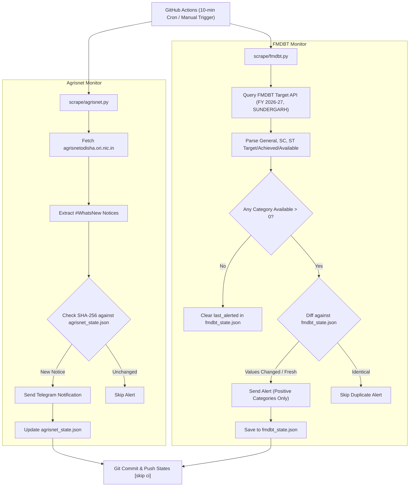

# Odisha Agri Alerts

[](https://github.com/dhiraj-patra/Odisha-Agri-Alerts/actions/workflows/alert.yml)
[](https://www.python.org/downloads/)

A lightweight, serverless Telegram bot that monitors Odisha agriculture portals for real-time announcements, DBT farm machinery targets, and positive implement availability.

Inspired by the clean architecture of [ezioMJ/Movie-Alert](https://github.com/ezioMJ/Movie-Alert), this bot runs 100% free on **GitHub Actions** with git-backed state persistence—no external servers, databases, or VPS required.

---

## Monitors Overview

### 1. Agrisnet Odisha Monitor (`scrape/agrisnet.py`)
- **Portal:** [AGRISNET Odisha](https://agrisnetodisha.ori.nic.in/)
- **Monitors:** "What's New" announcements and circulars.
- **Duplicate Prevention:** SHA-256 fingerprinting of notice text and target URLs.
- **Smart Bootstrap:** On the very first run, sends only the most recent notice as a confirmation ping while saving all existing notices as seen.
- **State File:** `agrisnet_state.json`

### 2. FMDBT Odisha Target Monitor (`scrape/fmdbt.py`)
- **Portal:** [Odisha FMDBT Target Status](https://fmdbt.agriodisha.nic.in/public/chktarget)
- **Monitored Configuration:**
  - **Financial Year:** `2026-27`
  - **District:** `SUNDERGARH`
  - **Monitored Implements:**
    - `SPL-POW- WEEDER`
    - `Reaper`
    - `Power Tiller`
- **Extracted Categories:** District-wise Target, Achieved, and Available figures for:
  - **General**
  - **Scheduled Caste (SC)**
  - **Scheduled Tribe (ST)**
- **Alerting Rules:**
  - **Availability Gate:** Notifies only when at least one category has `Available > 0`.
  - **Positive Filtering:** Includes strictly categories with positive availability in the message.
  - **Duplicate Prevention:** Tracks alerted values per implement in `fmdbt_state.json`.
  - **Change Detection & Re-arming:** Sends updated alerts when report values change, and automatically triggers fresh alerts when availability becomes positive again after being exhausted.
- **State File:** `fmdbt_state.json`

---

## Message Format Samples

### Agrisnet Notice Sample
```text
<b>Date:</b> 15-10-2026

The booking page will be closed from 03.00 PM on Dt.31.08.2026 for the top-up of the target of farm machinery. The bookings will start phase-wise from 10.30 AM on 01.09.2026. The slot details are as follows: <a href="https://agrisnetodisha.ori.nic.in/BookingSchduleSep.html">https://agrisnetodisha.ori.nic.in/BookingSchduleSep.html</a>
```

### FMDBT Target Alert Sample
```text
🚜 <b>FMDBT Target Alert</b>
<b>Date:</b> 15-10-2026 02:00 PM
<b>Financial Year:</b> 2026-27
<b>District:</b> SUNDERGARH
<b>Implement:</b> Power Tiller

<b>Available Targets:</b>
• <b>Scheduled Caste (SC):</b> Available: <b>4</b> (Target: 21, Achieved: 17)
• <b>Scheduled Tribe (ST):</b> Available: <b>3</b> (Target: 25, Achieved: 22)

🔗 <a href="https://fmdbt.agriodisha.nic.in/public/chktarget">FMDBT Target Portal</a>
```

---

## How It Works



1. **Trigger:** GitHub Actions runs every ~10 minutes via cron (`4,14,24,34,44,54 * * * *`) or manually on demand.
2. **Execution:** Runs `scrape/agrisnet.py` and `scrape/fmdbt.py` independently.
3. **State Isolation:** `scrape/agrisnet.py` maintains `agrisnet_state.json` and `scrape/fmdbt.py` maintains `fmdbt_state.json`.
4. **State Persistence:** If any state file changes, the workflow automatically commits and pushes them back to GitHub.

---

## Setup Guide

### 1. Create a Telegram Bot
1. Open Telegram and search for **[@BotFather](https://t.me/BotFather)**.
2. Send `/newbot`, enter a name and a username for your bot.
3. Copy the HTTP API token provided by BotFather (e.g. `123456789:ABCdefGHIjklMNOpqrSTUvwxYZ`). This is your `TELEGRAM_BOT_TOKEN`.

### 2. Set Up Your Telegram Channel or Chat
- **Public Channel:** Add your bot as an **Administrator** with permission to **Post Messages**. Your `TELEGRAM_CHAT_ID` is your channel username (e.g. `@my_alerts_channel`).
- **Private Channel:** Add your bot as an **Administrator**. Forward any message from the channel to **[@userinfobot](https://t.me/userinfobot)** or **[@JsonDumpBot](https://t.me/JsonDumpBot)** to find the channel ID (e.g. `-1001234567890`). This is your `TELEGRAM_CHAT_ID`.
- **Personal Chat:** Start a chat with your bot, then visit `https://api.telegram.org/bot<YOUR_BOT_TOKEN>/getUpdates` to find your user ID.

### 3. Configure GitHub Repository

#### A. Set Repository Secrets
In your GitHub repository:
1. Navigate to **Settings** > **Secrets and variables** > **Actions**.
2. Click **New repository secret** and add:
   - `TELEGRAM_BOT_TOKEN`: Your Telegram Bot API token.
   - `TELEGRAM_CHAT_ID`: Your Telegram Channel or Chat ID.

#### B. Enable Workflow Write Permissions
GitHub Actions needs permission to commit updated state files:
1. Navigate to **Settings** > **Actions** > **General**.
2. Under **Workflow permissions**, select **Read and write permissions**.
3. Click **Save**.

### 4. Trigger & Test
1. Go to the **Actions** tab in your GitHub repository.
2. Select **Odisha Agri Alerts** from the left sidebar.
3. Click **Run workflow** > **Run workflow**.

---

## Project Structure

```text
Odisha-Agri-Alerts/
├── .github/
│   └── workflows/
│       └── alert.yml         # GitHub Actions workflow (10-min schedule & dispatch)
├── .gitignore                # Git ignore rules for Python
├── README.md                 # Project documentation and guide
├── requirements.txt          # Python dependencies (requests, lxml)
├── scrape/
│   ├── agrisnet.py           # AGRISNET Odisha announcement monitor
│   └── fmdbt.py              # FMDBT target and availability monitor
├── agrisnet_state.json        # Persistent state for AGRISNET notices
└── fmdbt_state.json          # Persistent state for FMDBT implements
```
