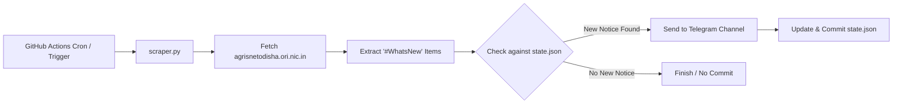

# Agrisnet Alert Bot

[](https://github.com/dhiraj-patra/Agrisnet-Alert-Bot/actions/workflows/alert.yml)
[](https://www.python.org/downloads/)

A lightweight, serverless Telegram bot that monitors the official **[AGRISNET Odisha](https://agrisnetodisha.ori.nic.in/)** portal for new **"What's New"** notifications and broadcasts instant alerts to your Telegram channel or chat.

Inspired by the clean architecture of [ezioMJ/Movie-Alert](https://github.com/ezioMJ/Movie-Alert), this bot runs 100% free on **GitHub Actions** with git-backed state persistence—no servers, databases, or VPS required.

---

## Features

- **Automated Polling:** Scheduled to run every 10 minutes via GitHub Actions cron.
- **Duplicate Prevention:** Computes SHA-256 fingerprints of notification text and URLs to guarantee zero duplicate alerts.
- **Smart Initial Bootstrap:** On its very first run, it sends **only the 1st (most recent) notification** as a confirmation ping, saving all 50+ existing notices as "seen" to prevent flooding the channel.
- **Clean Minimalist Format:** Posts plain-text notifications with raw clickable URLs for PDF notices and forms, ensuring zero Markdown/HTML parsing crashes on complex government text.
- **Git-Backed State Persistence:** Commits updated `state.json` back to the repository using GitHub Actions `[skip ci]`.

---

## Message Format Sample

```text
Agrisnet Odisha - What's New:

The booking page will be closed from 03.00 PM on Dt.31.08.2026 for the top-up of the target of farm machinery. The bookings will start phase-wise from 10.30 AM on 01.09.2026. The slot details are as follows:

Link: https://agrisnetodisha.ori.nic.in/BookingSchduleSep.html
```

---

## How It Works



1. **Trigger:** GitHub Actions fires every 10 minutes (or manually via `workflow_dispatch`).
2. **Fetch & Parse:** `scraper.py` fetches `https://agrisnetodisha.ori.nic.in/` using desktop browser headers and parses items inside the `#WhatsNew` container.
3. **Diffing:** It compares item SHA-256 hashes against `state.json`.
4. **Alert:** Brand-new announcements are posted in chronological order to the Telegram channel.
5. **Persist:** If new alerts were posted, `state.json` is automatically committed and pushed back to the repo. If nothing changed, git creates no commits.

---

## Setup Guide

### 1. Create a Telegram Bot

1. Open Telegram and search for **[@BotFather](https://t.me/BotFather)**.
2. Send `/newbot`, enter a name and a username for your bot.
3. Copy the HTTP API token provided by BotFather (e.g. `123456789:ABCdefGHIjklMNOpqrSTUvwxYZ`). This is your `TELEGRAM_BOT_TOKEN`.

### 2. Set Up Your Telegram Channel or Chat

#### For a Public Channel:
- Create a public channel and set its username (e.g. `@my_agrisnet_alerts`).
- Add your bot as an **Administrator** with permission to **Post Messages**.
- Your `TELEGRAM_CHAT_ID` is `@my_agrisnet_alerts`.

#### For a Private Channel:
- Create a private channel and add your bot as an **Administrator**.
- Forward any message from the channel to **[@JsonDumpBot](https://t.me/JsonDumpBot)** or **[@userinfobot](https://t.me/userinfobot)** to find the channel ID (usually starts with `-100`, e.g. `-1001234567890`).
- That ID is your `TELEGRAM_CHAT_ID`.

#### For Personal Chat:
- Start a chat with your bot (press `/start`).
- Open `https://api.telegram.org/bot<YOUR_BOT_TOKEN>/getUpdates` in your browser.
- Look for `"chat":{"id": 123456789}`. That number is your `TELEGRAM_CHAT_ID`.

---

### 3. Configure GitHub Repository

#### A. Set Repository Secrets
In your GitHub repository:
1. Navigate to **Settings** > **Secrets and variables** > **Actions**.
2. Click **New repository secret** and add:
   - `TELEGRAM_BOT_TOKEN`: Your Telegram Bot API token.
   - `TELEGRAM_CHAT_ID`: Your Telegram Channel or Chat ID.

#### B. Enable Workflow Write Permissions
GitHub Actions needs permission to commit the updated `state.json` back to your repo:
1. Navigate to **Settings** > **Actions** > **General**.
2. Scroll down to **Workflow permissions**.
3. Select **Read and write permissions**.
4. Click **Save**.

---

### 4. Trigger & Test

1. Go to the **Actions** tab in your GitHub repository.
2. Select **Agrisnet Alert Bot** from the left sidebar.
3. Click **Run workflow** > **Run workflow**.
4. Check your Telegram channel: you will receive the **1st latest notice** confirming the bot is active!
5. Future runs will execute automatically every 10 minutes and post only newly published notifications.

---

## Optional: External Trigger via cron-job.org

GitHub's built-in scheduler (`schedule.cron`) is best-effort and can experience delays during peak GitHub load. If you require guaranteed, clockwork 10-minute executions, you can trigger the workflow externally using [cron-job.org](https://cron-job.org) (as in `ezioMJ/Movie-Alert`):

1. Generate a GitHub Personal Access Token (PAT) with `Actions: Read and write` scope at **Settings > Developer settings > Personal access tokens**.
2. On [cron-job.org](https://cron-job.org), create a cronjob:
   - **URL:** `https://api.github.com/repos/<USERNAME>/<REPO>/actions/workflows/alert.yml/dispatches`
   - **Method:** `POST`
   - **Schedule:** Every 10 minutes
   - **Headers:**
     - `Accept: application/vnd.github+json`
     - `Authorization: Bearer <YOUR_GITHUB_PAT>`
     - `X-GitHub-Api-Version: 2022-11-28`
   - **Body:** `{"ref": "main"}`

---

## Project Structure

This repository is kept strictly minimal with only six files:

```text
Agrisnet-Alert-Bot/
├── .github/
│   └── workflows/
│       └── alert.yml        # GitHub Actions workflow
├── .gitignore               # Git ignore rules for Python
├── README.md                # Documentation and setup instructions
├── requirements.txt         # Python dependencies (requests, lxml)
├── scraper.py               # Core scraper, parser, and Telegram dispatcher
└── state.json               # Auto-managed persistent tracking state
```
